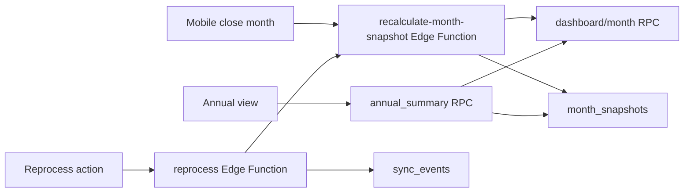

# Fechamento e Endurecimento Design

**Spec**: `.specs/features/closing-hardening/spec.md`
**Status**: Approved

---

## Architecture Overview

Fechamento é uma operação server-side que calcula o mês via mesma base do dashboard e persiste `month_snapshots`. O consolidado anual do MVP lê snapshots quando disponíveis e usa fallback controlado por view/RPC, sempre com semântica de competência. Reprocessamentos e operações críticas geram eventos auditáveis.



---

## Code Reuse Analysis

### Existing Components to Leverage

| Component | Location | How to Use |
| --- | --- | --- |
| Núcleo mensal | `.specs/features/monthly-core/` | Reusar cálculo do dashboard |
| Sync/conciliação | `.specs/features/pluggy-sync-reconciliation/` | Reprocessar matching e eventos |
| Contrato de dados | `docs/data-contract-schema-spec.md` | `month_snapshots`, `sync_events`, RLS |
| Stack técnica | `docs/stack-tecnica-supabase-mvp.md` | Validação obrigatória e comandos por Edge Functions |

### Integration Points

| System | Integration Method |
| --- | --- |
| Postgres | RPCs de snapshot e consolidado |
| Edge Functions | Recalcular snapshot, reprocessar e validar comandos |
| Mobile | Tela de fechamento, anual e status de sync |

---

## Components

### Month Snapshot Function

- **Purpose**: Calcular e persistir snapshot de um mês.
- **Location**: `supabase/functions/recalculate-month-snapshot/`
- **Interfaces**:
  - `POST /functions/v1/recalculate-month-snapshot`
- **Dependencies**: `get_month_dashboard`, `month_snapshots`, service role.
- **Reuses**: Dashboard RPC.

### Annual Summary Read Model

- **Purpose**: Expor consolidado anual por mês e categoria.
- **Constraint**: No MVP, o read model anual usa apenas competência; liquidação fica para evolução futura.
- **Location**: `supabase/migrations/` como view/RPC.
- **Interfaces**:
  - `get_annual_summary(p_year int): jsonb`
- **Dependencies**: `month_snapshots`, categorias.
- **Reuses**: snapshot payload.

### Reprocess Function

- **Purpose**: Reprocessar matching/snapshot de forma auditável.
- **Location**: `supabase/functions/reprocess-financial-data/`
- **Interfaces**:
  - `POST /functions/v1/reprocess-financial-data`
- **Dependencies**: `sync_events`, matching engine, snapshot function.
- **Reuses**: rotinas de sync/conciliação.

### Security Test Suite

- **Purpose**: Validar RLS, RPCs e Edge Functions com dois usuários.
- **Location**: `supabase/tests/` ou scripts de validação do projeto.
- **Interfaces**:
  - `npm run test:rls` ou comando equivalente.
- **Dependencies**: Supabase local.
- **Reuses**: fixtures da fundação e features anteriores.

### Annual and Sync Status UI

- **Purpose**: Mostrar consolidado anual e status mínimo de sync.
- **Location**: `mobile/src/features/reports/` e `mobile/src/features/settings/`
- **Interfaces**:
  - `useAnnualSummary(year)`
  - `useConnectionStatus()`
- **Dependencies**: Supabase RPC/views.
- **Reuses**: Mobile shell, TanStack Query.

---

## Data Models

### `AnnualSummary`

```typescript
interface AnnualSummary {
  year: number
  months: Array<{
    month: string
    plannedIncomeCents: number
    actualIncomeCents: number
    plannedExpenseCents: number
    actualExpenseCents: number
    expectedBalanceCents: number
    currentBalanceCents: number
  }>
  categories: Array<{
    categoryId: string
    categoryCode: string
    name: string
    plannedCents: number
    actualCents: number
    deltaCents: number
  }>
}
```

### `ReprocessRequest`

```typescript
interface ReprocessRequest {
  month?: string
  connectionId?: string
  scope: 'SNAPSHOT' | 'MATCHING' | 'SYNC_EVENT'
  syncEventId?: string
}
```

---

## Error Handling Strategy

| Error Scenario | Handling | User Impact |
| --- | --- | --- |
| Snapshot falha | Mantém snapshot anterior e registra erro | Usuário vê erro de tentativa |
| Sem snapshots no ano | RPC retorna dados vazios/fallback | Tela anual não quebra |
| Reprocessamento concorrente | Lock lógico ou status em evento | Evita corrupção |
| RLS falha em teste | Bloqueia release da milestone | Não segue para produção |

---

## Tech Decisions

| Decision | Choice | Rationale |
| --- | --- | --- |
| Fechamento | Snapshot informativo recalculável | Permite correção pós-fechamento |
| Consolidado anual | RPC por competência usando snapshots com fallback | Leitura rápida e resiliente sem ambiguidade semântica no MVP |
| Reprocessamento | Edge Function auditada | Evita lógica crítica no cliente |
| Segurança | Teste obrigatório multiusuário | Domínio financeiro exige isolamento |
