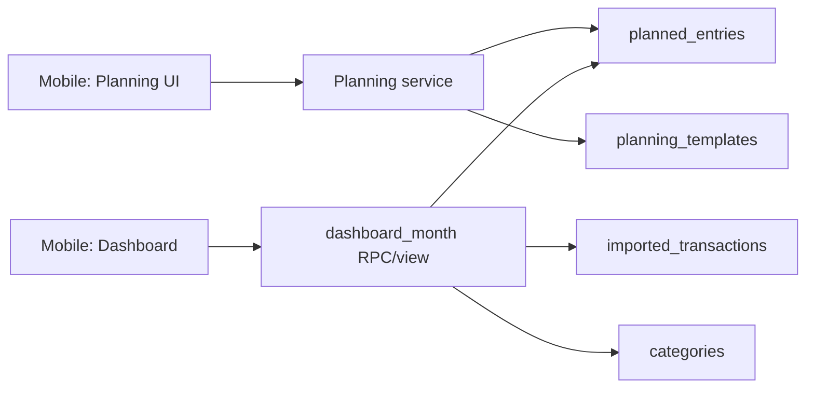

# Núcleo Mensal do Produto Design

**Spec**: `.specs/features/monthly-core/spec.md`
**Status**: Approved

---

## Architecture Overview

O núcleo mensal usa Postgres como fonte de verdade, views/RPC para leituras agregadas e Edge Functions/RPCs controladas para comandos que geram ocorrências. O app mobile consome hooks de planejamento e dashboard, sem calcular totais críticos no cliente.



---

## Code Reuse Analysis

### Existing Components to Leverage

| Component | Location | How to Use |
| --- | --- | --- |
| Fundação Supabase + Mobile | `.specs/features/foundation-supabase-mobile/` | Base de auth, RLS, schema, cliente Supabase |
| Contrato de dados | `docs/data-contract-schema-spec.md` | Fonte dos modelos `planning_templates`, `planned_entries`, `month_snapshots` |
| Stack técnica | `docs/stack-tecnica-supabase-mvp.md` | Padrão views/RPC para leitura e Edge Functions para comandos sensíveis |
| Design system GGastos | `mobile/src/components/ggastos/` e `mobile/src/constants/ggastos-theme.ts` | Reutilizar primitives, cards, rows e navegação em vez de redesenhar o dashboard/planning |
| Shell autenticado do app | `mobile/src/features/app-shell/` | Manter a casca autenticada existente e plugar features reais por aba |
| Dashboard mockado | `mobile/src/features/dashboard/` | Evoluir a tela existente substituindo dados mockados por leitura real do Supabase |

### Integration Points

| System | Integration Method |
| --- | --- |
| Supabase Auth/RLS | `user_id = auth.uid()` nas tabelas de usuário |
| Postgres | RPC/view `get_month_dashboard(month)` e views auxiliares |
| Mobile | TanStack Query para leitura e invalidação por mês |
| UI Shell | Expo Router com `AppShell` autenticado e abas locais |

---

## Components

### Planning Feature

- **Purpose**: Criar, editar, cancelar e listar planejamentos do mês.
- **Location**: `mobile/src/features/planning/`
- **Interfaces**:
  - `createPlannedEntry(input): Promise<PlannedEntry>`
  - `createPlanningTemplate(input): Promise<PlanningTemplate>`
  - `cancelPlannedEntry(id): Promise<void>`
  - `listPlannedEntries(month): Promise<PlannedEntry[]>`
- **Dependencies**: Supabase client, Zod schemas, TanStack Query.
- **Reuses**: `planned_entries`, `planning_templates`, `categories`.

### Planned Entry Generation

- **Purpose**: Gerar ocorrências mensais a partir de templates recorrentes/parcelados.
- **Location**: `supabase/functions/generate-planned-entries/` ou RPC equivalente.
- **Interfaces**:
  - `generate_planned_entries(user_id, month): generated_count`
- **Dependencies**: Postgres, service role em execução interna.
- **Reuses**: `planning_templates`, `planned_entries`.

### Month Dashboard Read Model

- **Purpose**: Calcular resumo mensal e totais por categoria.
- **Location**: `supabase/migrations/` como view/RPC.
- **Interfaces**:
  - `get_month_dashboard(p_month text): jsonb`
- **Dependencies**: Postgres, RLS, categorias globais.
- **Reuses**: `planned_entries`, `imported_transactions`, `reconciliation_matches`, `categories`.

### Dashboard Feature

- **Purpose**: Renderizar resumo mensal, categorias e estado vazio.
- **Location**: `mobile/src/features/dashboard/`
- **Interfaces**:
  - `useMonthDashboard(month): QueryResult<MonthDashboard>`
  - `useCategoryDetails(month, categoryId): QueryResult<CategoryDetails>`
- **Dependencies**: TanStack Query, Supabase RPC.
- **Reuses**: Mobile shell da fundação, design system GGastos e scaffold de dashboard já existente com dados mockados.

---

## Data Models

### `PlanningTemplateInput`

```typescript
interface PlanningTemplateInput {
  title: string
  impactType: 'INCOME' | 'EXPENSE' | 'INVESTMENT' | 'TRANSFER'
  categoryId: string
  defaultAmountCents: number
  recurrenceFrequency: 'NONE' | 'MONTHLY' | 'YEARLY'
  recurrenceInterval: number
  startMonth: string
  endMonth?: string
  installmentTotal?: number
  installmentAmountCents?: number
}
```

### `MonthDashboard`

```typescript
interface MonthDashboard {
  month: string
  summary: {
    plannedIncomeCents: number
    actualIncomeCents: number
    plannedExpenseCents: number
    actualExpenseCents: number
    plannedInvestmentCents: number
    actualInvestmentCents: number
    expectedBalanceCents: number
    currentBalanceCents: number
    committedRemainingCents: number
  }
  categories: Array<{
    categoryId: string
    categoryCode: string
    name: string
    plannedCents: number
    actualCents: number
    deltaCents: number
  }>
}
```

---

## Error Handling Strategy

| Error Scenario | Handling | User Impact |
| --- | --- | --- |
| Categoria inativa | Validação server-side bloqueia criação | Usuário escolhe outra categoria |
| Duplicidade de ocorrência | Constraint/idempotência evita insert duplicado | Usuário não vê duplicatas |
| RPC sem dados | Retorna payload zerado | Dashboard abre em estado vazio |
| RLS nega acesso | Erro tratado no service | Usuário não vê dados indevidos |

---

## Tech Decisions

| Decision | Choice | Rationale |
| --- | --- | --- |
| Dashboard | View/RPC em Postgres | Mantém cálculo financeiro fora do cliente |
| Recorrências | Enum + interval | Suficiente para MVP, evita RRULE |
| Geração | Idempotente por template/mês/índice | Evita duplicidade em retries |
| Transferência | Neutra por padrão | Evita falso gasto/receita |
