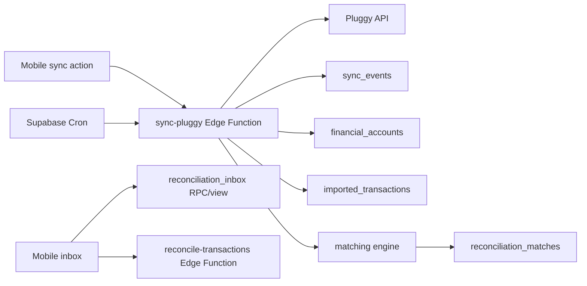

# Sync Pluggy e Conciliação Design

**Spec**: `.specs/features/pluggy-sync-reconciliation/spec.md`
**Status**: Approved

---

## Architecture Overview

O sync roda em Edge Functions com service role e segredos server-side. A função busca dados na API direta da Pluggy, normaliza para tabelas internas, registra eventos e dispara matching automático. A inbox é leitura por view/RPC e decisões manuais passam por Edge Function para manter auditoria.



---

## Code Reuse Analysis

### Existing Components to Leverage

| Component | Location | How to Use |
| --- | --- | --- |
| Fundação sync stub | `.specs/features/foundation-supabase-mobile/` | Evoluir `sync-pluggy` de stub para implementação real |
| Núcleo mensal | `.specs/features/monthly-core/` | Matching usa planejamentos e dashboard invalida após sync |
| Contrato de dados | `docs/data-contract-schema-spec.md` | Fonte para contas, transações, matches e eventos |

### Integration Points

| System | Integration Method |
| --- | --- |
| Pluggy API | Edge Function server-side |
| Supabase Cron | Dispara sync agendado a cada 12 horas |
| Postgres | Upsert idempotente e views/RPC |
| Mobile | Sync manual, status de conexão e inbox |

---

## Components

### Pluggy API Client

- **Purpose**: Encapsular autenticação e chamadas à Pluggy.
- **Location**: `supabase/functions/_shared/pluggy-client.ts`
- **Interfaces**:
  - `fetchConnections(): Promise<PluggyConnection[]>`
  - `fetchAccounts(itemId): Promise<PluggyAccount[]>`
  - `fetchTransactions(accountId, cursor): Promise<PluggyTransaction[]>`
- **Dependencies**: Pluggy secrets, fetch API.
- **Reuses**: Environment secrets do Supabase.

### Sync Orchestrator

- **Purpose**: Coordenar sync manual/agendado, logging e upserts.
- **Location**: `supabase/functions/sync-pluggy/`
- **Interfaces**:
  - `POST /functions/v1/sync-pluggy`
- **Dependencies**: Pluggy API Client, service role, `sync_events`.
- **Reuses**: Stub da fundação.

### Normalizers

- **Purpose**: Converter payload Pluggy em modelos internos estáveis.
- **Location**: `supabase/functions/_shared/normalizers/`
- **Interfaces**:
  - `normalizeAccount(payload): FinancialAccountUpsert`
  - `normalizeTransaction(payload): ImportedTransactionUpsert`
- **Dependencies**: contrato de dados.
- **Reuses**: `provider_payload` para auditoria.

### Matching Engine

- **Purpose**: Calcular score entre transações e planejamentos elegíveis.
- **Location**: `supabase/functions/_shared/reconciliation/`
- **Interfaces**:
  - `scoreMatch(transaction, plannedEntry): MatchScore`
  - `autoMatch(transactionId): Promise<MatchResult>`
- **Dependencies**: `planned_entries`, `imported_transactions`, `reconciliation_matches`.
- **Reuses**: regras do TDD.

### Reconciliation Inbox

- **Purpose**: Expor sugestões pendentes para revisão.
- **Location**: `supabase/migrations/` como view/RPC + `mobile/src/features/reconciliation/`
- **Interfaces**:
  - `get_reconciliation_inbox(p_month text): jsonb`
  - `confirmMatch(plannedEntryId, transactionId)`
  - `rejectMatch(plannedEntryId, transactionId)`
- **Dependencies**: RLS, Edge Function para comandos.
- **Reuses**: `reconciliation_matches`.

---

## Data Models

### `MatchScore`

```typescript
interface MatchScore {
  score: number
  amountDeltaCents: number
  dateDeltaDays: number
  rationale: {
    amount: number
    date: number
    category: number
    account: number
    description: number
  }
}
```

### `SyncResult`

```typescript
interface SyncResult {
  syncEventId: string
  status: 'RECEIVED' | 'PROCESSED' | 'FAILED'
  accountsProcessed: number
  transactionsProcessed: number
  matchesCreated: number
}
```

---

## Error Handling Strategy

| Error Scenario | Handling | User Impact |
| --- | --- | --- |
| Consentimento expirado | Atualiza conexão com `LOGIN_ERROR`/mensagem acionável | Usuário vê orientação para resolver na Pluggy |
| Payload duplicado | Upsert ignora duplicidade | Sem duplicatas |
| Pluggy indisponível | `sync_events` como `FAILED` e erro transitório | Usuário pode tentar depois |
| Match conflitante | Constraint bloqueia segundo match ativo | Usuário vê item já conciliado |

---

## Tech Decisions

| Decision | Choice | Rationale |
| --- | --- | --- |
| Integração | API direta server-side | Produto não expõe segredos |
| Idempotência | Upsert por IDs Pluggy | Suporta retries |
| Matching | Score determinístico 1:1 | Auditável e simples para MVP |
| Rejeição | Registro em `reconciliation_matches` com status `REJECTED` | Evita ressugerir par rejeitado |
| Inbox | View/RPC + comandos por Edge Function | Leituras rápidas e comandos auditáveis |
