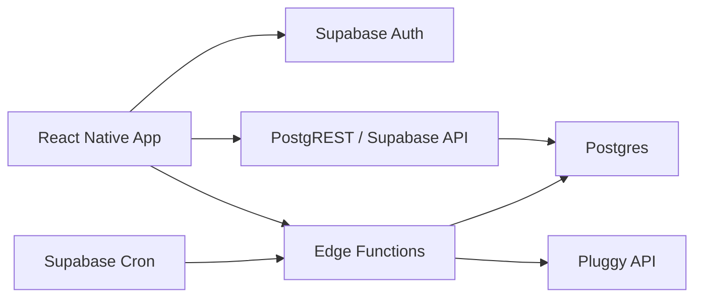

# Stack Técnica - GGastos MVP com Supabase

## Metadados
- Projeto: GGastos
- Data: 2026-07-10
- Status: Baseline histórico; estratégia ativa revisada em 2026-08-05

## Estratégia ativa

O Supabase, Expo, Auth/RLS, Edge Functions, Postgres e TanStack Query continuam
como stack ativa. A ingestão externa agora é a Edge Function
`import-card-statement`, que normaliza CSVs Nubank/Bradesco e aciona a
conciliação existente. A integração Pluggy, seu cron e seus segredos foram
retirados do fluxo ativo e preservados apenas na branch
`pluggy-integration-snapshot`.

As seções abaixo descrevem o baseline de arquitetura de 2026-07-10. Onde
mencionarem Pluggy ou `sync-pluggy`, devem ser lidas como histórico.

## Decisão
O backend do MVP será construído sobre **Supabase**.

## Objetivo da stack
Maximizar velocidade de entrega sem sacrificar o modelo de dados necessário para:
- planejamento mensal;
- conciliação entre planejado e realizado;
- sincronização com Pluggy;
- segurança por usuário;
- consultas agregadas por mês e por categoria.

## Stack escolhida

### Mobile
- **React Native**
- **Expo** como camada de desenvolvimento do app, salvo bloqueio nativo concreto
- **TypeScript**
- **React Navigation**
- **TanStack Query** para cache, sync e invalidação
- **Zod** para validação de contratos no app
- **Supabase JS** para auth e acesso controlado aos dados

### Backend/Platform
- **Supabase Postgres**
- **Supabase Auth**
- **Row Level Security (RLS)**
- **Supabase Edge Functions**
- **Supabase Cron** com `pg_cron`
- **Supabase Storage** apenas se surgir necessidade de anexos depois

### Integração externa
- **Pluggy** via API direta server-side
- **MCP/CLI da Pluggy** apenas como apoio de descoberta operacional quando útil
- Segredos da Pluggy armazenados em secrets do Supabase

### Qualidade e DX
- **Supabase CLI** para migrations e ambiente local
- **SQL migrations** versionadas
- **TypeScript** para Edge Functions
- **ESLint + Prettier**
- **Jest/Vitest** onde fizer sentido para lógica isolada

## Escolhas fechadas

### 1. Banco relacional
Usar Postgres como fonte principal de verdade.

Motivo:
- o domínio do GGastos é relacional;
- haverá joins e agregações frequentes;
- competência mensal, conciliação e snapshots são mais naturais em SQL;
- evita modelagem artificial em NoSQL.

### 2. Auth
Usar **Supabase Auth** com:
- e-mail/senha no MVP;
- possibilidade futura de magic link;
- usuário autenticado mapeado diretamente para RLS.

### 3. Segurança de dados
Usar:
- RLS em todas as tabelas expostas;
- `service_role` apenas em Edge Functions e jobs internos;
- nenhum segredo Pluggy no app mobile.

### 4. Backend de negócio
Usar **Edge Functions** para:
- sincronização manual com Pluggy;
- jobs disparados por cron;
- endpoints de orquestração que não devem ficar no cliente;
- operações de conciliação mais sensíveis.

### 5. Agendamento
Usar **Supabase Cron** para:
- sync periódico com Pluggy;
- recálculo de snapshots mensais;
- geração de entradas recorrentes futuras;
- housekeeping técnico simples.

Padrão aprovado para o MVP real:
- sync agendado a cada `12 horas`.

### 6. Acesso do app
Separar dois modos:
- leitura simples por `supabase-js` quando o dado estiver seguro por RLS;
- chamadas a Edge Functions para operações de sync, conciliação e comandos de domínio.

## O que não entra no MVP
- microserviços separados;
- NestJS/Express dedicados;
- fila externa como BullMQ/SQS;
- GraphQL;
- event bus complexo;
- analytics enterprise;
- multi-tenant além de usuário individual.

## Arquitetura lógica



## Estrutura proposta do domínio

### Módulos principais
- `auth`
- `connections`
- `accounts`
- `imported_transactions`
- `planning_templates`
- `planned_entries`
- `reconciliation`
- `month_snapshots`
- `categories`
- `sync_events`

### Tabelas principais
- `profiles`
- `financial_connections`
- `financial_accounts`
- `categories`
- `imported_transactions`
- `planning_templates`
- `planned_entries`
- `reconciliation_matches`
- `user_category_rules`
- `month_snapshots`
- `sync_events`

## Responsabilidades por camada

### React Native
- login/logout;
- seleção de mês;
- dashboard;
- detalhe por categoria;
- criação e edição de planejamentos;
- inbox de conciliação;
- disparo de sincronização;
- cache local de leitura.

### Postgres
- storage principal do domínio;
- integridade referencial;
- views e RPCs de leitura agregada;
- snapshots e consultas mensais.

### Edge Functions
- sync com Pluggy;
- upsert de contas, saldos, investimentos e transações;
- reconciliação automática;
- geração de recorrências;
- recálculo de snapshots.
- comandos sensíveis de domínio.

## Padrão de acesso a dados

### Consultas de leitura
Preferência:
1. `views` SQL para dashboard e consolidado;
2. `rpc` quando houver cálculo parametrizado;
3. acesso direto a tabelas apenas para telas CRUD simples.

### Escritas
Preferência:
1. Edge Functions para operações sensíveis;
2. inserts/updates diretos com RLS apenas quando o domínio for trivial.

Regra: dados importados da Pluggy preservam campos de origem; o cliente só pode
alterar metadados internos permitidos.

## Estratégia de sync com Pluggy

### Manual
O app chama uma Edge Function `sync-pluggy`.

### Agendado
Cron dispara a mesma função com contexto interno, por padrão a cada `12 horas`.

### Pipeline
1. Buscar conexões ativas do usuário ou do sistema.
2. Consultar Pluggy.
3. Normalizar payload.
4. Fazer upsert idempotente.
5. Tentar conciliação automática.
6. Recalcular snapshot do mês impactado.
7. Persistir log em `sync_events`.

Na fundação, `sync-pluggy` pode ser stub autenticado, mas o contrato deve nascer
compatível com a implementação final via API direta server-side.

## Estratégia de segurança

### RLS
Todas as tabelas de domínio com `user_id` devem ter políticas por usuário.
`categories` é catálogo global com leitura autenticada. `sync_events.user_id` é
opcional: eventos de usuário são visíveis ao dono; eventos sem usuário ficam
restritos ao backend/service role.

### Segredos
- `SUPABASE_SERVICE_ROLE_KEY` apenas server-side;
- segredos Pluggy apenas em environment secrets;
- nenhuma credencial Pluggy embarcada no app.

### Auditoria
Registrar:
- sync manual;
- sync agendado;
- conciliações automáticas;
- conciliações manuais;
- alterações relevantes de planejamento.

## Validação Obrigatória da Fundação

- Migrations aplicam em banco limpo.
- Seed global de categorias é aplicada sem duplicidade.
- App mobile compila/inicia no shell mínimo.
- Login/cadastro/sessão funcionam.
- RLS é validada com dois usuários distintos.
- Edge Function `sync-pluggy` aceita chamada autenticada e registra `sync_events`.
- Cliente não usa `service_role` nem segredo Pluggy.

## Estrutura inicial do repositório

```text
docs/
mobile/
supabase/
  migrations/
  functions/
```

## Estrutura inicial do `mobile/`

```text
mobile/
  app/
  src/
    components/
    features/
      auth/
      dashboard/
      planning/
      reconciliation/
      settings/
    lib/
      supabase/
      zod/
      query/
    hooks/
    types/
```

## Estrutura inicial do `supabase/functions/`

```text
supabase/functions/
  sync-pluggy/
  reconcile-transactions/
  recalculate-month-snapshot/
  generate-planned-entries/
```

## Ordem de implementação

### Fase 1
- criar projeto Supabase;
- configurar Auth;
- criar migrations base;
- habilitar RLS;
- criar app mobile com login.

### Fase 2
- implementar categorias, planejamentos e dashboard sem Pluggy;
- criar views de leitura mensal;
- validar conceito de `previsto vs. realizado`.

### Fase 3
- implementar Edge Function de sync com Pluggy;
- persistir contas, saldos e transações;
- montar inbox de conciliação.

### Fase 4
- cron de sync;
- snapshots;
- consolidado anual;
- endurecimento de segurança e observabilidade.

## Tradeoffs aceitos
- Edge Functions não são boas para jobs longos, então o sync deve ser curto, idempotente e incremental.
- Parte da lógica de agregação ficará em SQL, o que aumenta dependência de banco, mas reduz complexidade do app.
- Expo acelera o MVP, mas pode ser revisto se houver necessidade nativa específica depois.

## Recomendação final
Para este MVP:
- **Supabase** como backend completo;
- **Postgres + RLS** como núcleo do domínio;
- **Edge Functions + Cron** para integração com Pluggy e automações;
- **React Native + Expo** no mobile para acelerar entrega.
