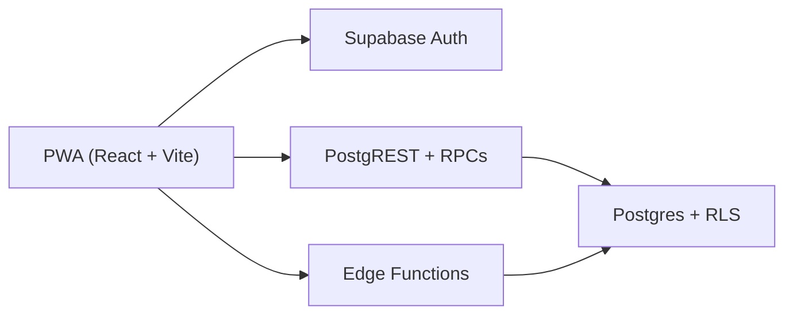

# Arquitetura e stack do GGastos

## Metadados
- Projeto: GGastos
- Atualizado em: 2026-11-06
- Status: **Ativo.** Substitui o baseline de 2026-07-10, preservado em
  [`archive/stack-tecnica-baseline-2026-07.md`](archive/stack-tecnica-baseline-2026-07.md)
  (React Native/Expo, Pluggy e cron de sync, todos descartados).

## Visão geral

App web instalável (PWA) de finanças pessoais, centrado em `planejado vs. realizado`, sobre
Supabase. Os dados entram por lançamentos manuais, templates recorrentes/parcelados e importação
de faturas CSV (Nubank e Bradesco); a conciliação cruza o planejado com o realizado.



## Front-end

- **React 19 com react-native-web:** a UI usa as primitivas do React Native (`View`, `Text`,
  `StyleSheet`) e roda no navegador. Não há app nativo nem Expo.
- **Vite** para dev server e build (`dist/`), **TypeScript** estrito.
- **TanStack Query** para cache; depois de mudar lançamentos, `invalidateMonthData` atualiza mês,
  categorias e relatórios.
- **Zod** para contratos de entrada e saída (`contract.ts` de cada feature).
- **supabase-js** para auth e dados; chaves públicas via `VITE_*`.
- **PWA:** `public/manifest.webmanifest`, `sw.js` e `register-sw.js`. Deploy na Vercel (`vercel.json`).
- **Organização:** fatias por feature em `src/features/`, base em `src/shared/`, fronteiras
  garantidas pelo ESLint. Detalhes e convenções em [`../CLAUDE.md`](../CLAUDE.md).

## Backend (Supabase)

- **Postgres** como fonte de verdade: o domínio é relacional (competência mensal, conciliação,
  snapshots). Migrations versionadas em `supabase/migrations/`.
- **Auth** por e-mail e senha; o usuário autenticado vale direto nas políticas de **RLS**.
- **RPCs `security invoker`** para leituras agregadas e comandos de domínio, por exemplo
  `get_month_dashboard`, `get_annual_summary`, `set_statement_payment_status`,
  `plan_future_installments` (só `service_role`) e as de template.
- **Edge Functions** (`supabase/functions/`), cada `index.ts` só com HTTP, auth e erros:

  | Função | Papel |
  |---|---|
  | `import-card-statement` | Lê o CSV, grava lote e linhas de forma idempotente, planeja parcelas futuras e roda a conciliação automática |
  | `reconciliation-inbox` | Lista as sugestões de conciliação do mês (GET) |
  | `reconcile-transactions` | Aplica a decisão do usuário sobre uma sugestão: confirmar, rejeitar ou desfazer |
  | `recalculate-month-snapshot` | Fechamento e recálculo do mês |

  A regra de negócio fica em `_shared/<domínio>/` (`statement-import`, `statements`,
  `reconciliation`, `closing`), com testes `*.test.mjs` ao lado.

### Tabelas principais
`profiles`, `categories`, `financial_connections`, `financial_accounts`, `imported_transactions`,
`statement_import_batches`, `planning_templates`, `planned_entries`, `reconciliation_matches`,
`user_category_rules`, `month_snapshots`, `wallet_settings`, `sync_events`.
Contrato completo em [`data-contract-schema-spec.md`](data-contract-schema-spec.md).

**Carteira.** É o saldo de hoje, não de um mês. `wallet_settings` guarda o mês de início e o saldo
inicial; `get_wallet(mês atual)` soma o movimento liquidado de cada mês desde o início, e
`set_wallet_balance` recalcula o saldo inicial para a carteira mostrar o valor informado. Meses
anteriores ao início (faturas antigas importadas só para o histórico) nunca alteram a carteira.
`month_opening_balances` e suas RPCs não são mais usadas pelo app.

**Tipo do lançamento.** `planned_entries.impact_type` e `planning_templates.impact_type` são
escolhidos no formulário e não precisam coincidir com o da categoria. `get_month_dashboard`
devolve uma linha por categoria e por tipo.

## Padrões de acesso a dados

- **Leitura:** RPC ou view para o que é agregado (dashboard, anual); tabela direta só em CRUD simples.
- **Escrita:** direta com RLS quando o domínio é trivial; Edge Function ou RPC para operações
  sensíveis ou em várias etapas (importação, fechamento, pagamento de fatura).
- Linhas importadas preservam os campos de origem; o usuário só altera metadados internos
  (categoria, nota, situação de pagamento).

## Segurança

- RLS em todas as tabelas com `user_id`; `categories` é catálogo com leitura autenticada.
- `SUPABASE_SERVICE_ROLE_KEY` só dentro das Edge Functions. O app nunca a recebe.
- Variáveis `VITE_*` vão para o bundle: só URL e chave pública.
- Arquivos reais de fatura nunca são versionados; os testes usam fixtures sintéticas.

## Desenvolvimento e testes

```bash
supabase start && supabase db reset     # banco local com seed
npm run web                             # app em http://localhost:5173
npm run typecheck && npm run lint       # tipos e fronteiras entre features
npm test                                # Vitest: regras puras e contratos do front
npm run test:backend                    # node:test das Edge Functions (Node 22+)
supabase/tests/run-hardening-checklist.sh   # reset de migrations + suíte de RLS
```

As suítes `supabase/tests/*-suite.mjs` são de integração e exigem o Supabase local em execução.

## Decisões e limites

- Sem microserviços, filas, GraphQL ou multi-tenant além de um usuário por conta.
- Edge Functions não servem para jobs longos: operações curtas, idempotentes e incrementais.
- Parte da agregação fica em SQL: mais dependência do banco, menos lógica no app.
- Não há agendamento ativo. O cron de sync da Pluggy foi desligado na migration
  `20260805123000_unschedule_sync_pluggy_cron.sql`.
