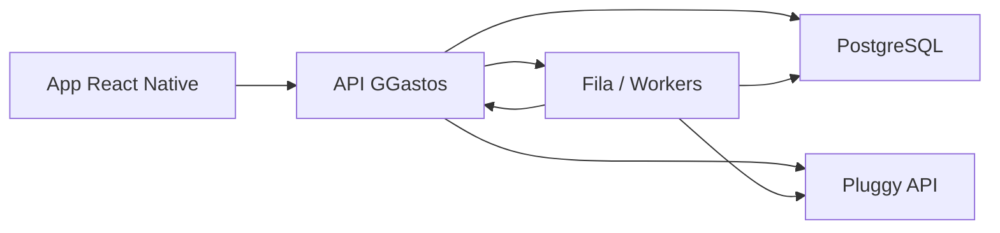

# TDD - GGastos v2

## Metadados
- Projeto: GGastos v2
- Data: 2026-07-10
- Status: Baseline histórico; estratégia ativa revisada em 2026-08-05
- Idioma: PT-BR

## Estratégia ativa

O fluxo de ingestão em produção é importação de CSV de faturas Nubank/Bradesco
pela Edge Function `import-card-statement`, com persistência idempotente em
`imported_transactions` e conciliação reutilizada. Pluggy e `sync-pluggy` são
histórico preservado, não dependências de runtime nem alvos de deploy.

A especificação técnica ativa está em
`.specs/features/card-statement-import/` e o resumo operacional em
[`card-statement-import.md`](card-statement-import.md).

## Contexto
O GGastos v2 precisa preservar a lógica valiosa da planilha original, mas trocar a base operacional de lançamento manual por uma arquitetura com ingestão automática de dados financeiros via Pluggy. O valor central do produto é o motor de `planejado vs. realizado`, e não apenas a importação bancária.

## Definição do Problema
O código atual não suporta o objetivo do produto por limitações estruturais:
- persistência somente local em `AsyncStorage`;
- ausência de identidade de usuário e backend;
- modelo de compra acoplado à UI;
- compras parceladas replicadas por mês sem trilha de origem robusta;
- categorias estáticas e sem reconciliação;
- ausência de backend de sincronização, trilha de auditoria e observabilidade.

Além disso, há sinais de inconsistência no baseline:
- o mês é manipulado com semânticas divergentes entre `Date` nativo e `MonthModel`;
- `usePurchaseData` adiciona o retorno inteiro de `savePurchase` ao estado local como se fosse item único;
- telas de `Charts` e `Settings` ainda são placeholders;
- a UI atual não separa claramente planejado, importado, conciliado e pago.

## Escopo

### Dentro do escopo
- Nova arquitetura de backend para sincronização com Pluggy.
- Modelagem de contas, transações, planejamentos e conciliação.
- API para o app mobile.
- Sincronização por consulta (`pull`) e processamento assíncrono.
- Dashboard mensal e consolidado anual.

### Fora do escopo
- Execução de pagamentos via Pluggy no MVP.
- Suporte multi-tenant empresarial.
- Analytics avançado em tempo real.
- Refatoração incremental do storage local atual para produção.

## Solução Técnica

### Visão Geral
Adotar uma arquitetura `mobile + backend + banco relacional + workers leves de sync`, onde:
- o app mobile é responsável por autenticação, visualização e ações do usuário;
- o backend orquestra Pluggy, persistência, regras de negócio e segurança;
- a sincronização com a Pluggy ocorre por consulta aos próprios dados disponíveis no modo pessoal/free;
- o motor de planejamento e conciliação vive no backend;
- o mobile consome views agregadas já prontas para dashboard.

### Componentes
1. App Mobile React Native
- autenticação do usuário;
- fluxo de sincronização manual e visualização do estado da origem;
- telas mensais, categorias, inbox de conciliação e configurações;
- cache local apenas para experiência, nunca como fonte de verdade.

2. API Backend
- expõe APIs de leitura e comando;
- armazena usuários, conexões, contas, transações e planejamentos;
- executa sync, matching, categorização interna e snapshots mensais.

3. Banco de Dados Relacional
- system of record para domínio financeiro do GGastos;
- forte integridade referencial;
- trilha de auditoria para sync e conciliação.

4. Workers/Jobs
- executam sync assíncrono;
- recalculam snapshots;
- geram ocorrências futuras de recorrências/parcelas;
- reprocessam conciliações quando necessário.

5. Integração Pluggy
- leitura dos próprios dados disponíveis no modo pessoal/free da Pluggy;
- descoberta híbrida via MCP/CLI quando útil para mapear payloads reais;
- implementação de produto por API direta server-side em Edge Functions;
- uso do ambiente pessoal da Pluggy para consentimentos Open Finance;
- ausência de dependência em `Pluggy Connect`, `Connect Token` e webhooks comerciais.

## Arquitetura Lógica

## Fluxo de Conexão
1. Usuário conecta e gerencia seus consentimentos no ambiente pessoal da Pluggy.
2. Mobile ou backend solicita uma sincronização.
3. Backend autentica via API direta server-side da Pluggy e consulta os próprios dados disponíveis.
4. Backend captura contas, saldos, extrato e investimentos.
5. Backend normaliza e persiste os dados.

## Fluxo de Sincronização
1. Usuário dispara sincronização manual ou um job agendado dispara sincronização periódica.
2. Backend consulta a Pluggy e recupera o estado mais recente dos próprios dados liberados.
3. Backend valida idempotência por identificadores de origem e janela de sincronização.
4. Worker busca dados completos quando necessário.
5. Dados são normalizados no schema interno.
6. Motor de conciliação tenta vincular novas transações a planejamentos.
7. Views agregadas do mês são recalculadas.

## Modelo de Domínio

### Entidades principais
- `Profile`
- `FinancialConnection`
- `FinancialAccount`
- `ImportedTransaction`
- `Category`
- `UserCategoryRule`
- `PlanningTemplate`
- `PlannedEntry`
- `ReconciliationMatch`
- `MonthSnapshot`
- `SyncEvent`

### Princípios de modelagem
- Transação importada não deve ser sobrescrita como se fosse lançamento manual.
- Planejamento manual e importação bancária são origens diferentes do mesmo domínio.
- Conciliação cria vínculo entre origens, não fusão destrutiva.
- Agregações mensais são derivadas e regeneráveis.
- `Profile` é a tabela pública do domínio e referencia `auth.users`.
- Categorias são globais no MVP; personalização entra por regras do usuário.

## Estratégia de Dados

### Fonte de verdade
- Pluggy é fonte de verdade para dados importados de instituição.
- GGastos é fonte de verdade para:
  - categorias internas;
  - planejamentos;
  - regras do usuário;
  - conciliações;
  - snapshots mensais;
  - overrides semânticos.

### Imutabilidade parcial
- Campos brutos da transação importada devem ser preservados.
- Ajustes do usuário ficam em camadas anexas:
  - categoria interna;
  - notas;
  - flags;
  - vínculo de conciliação.
- Valor, data, descrição e payload de origem não devem ser editados pelo usuário.

### Observação sobre o plano free
- O design não deve assumir onboarding embutido no app, webhooks ou enriquecimento premium.
- A camada de domínio do GGastos deve continuar válida mesmo se a origem Pluggy for apenas uma fonte pessoal de leitura.

## Motor de Planejamento

### Tipos de planejamento
- Recorrência fixa mensal.
- Recorrência anual simples.
- Parcela futura conhecida.
- Lançamento avulso futuro.
- Receita esperada.

### Regras
- Planejamento pertence a uma competência mensal.
- Planejamento pode ter conta/cartão esperado, mas isso é opcional.
- Planejamento pode existir sem transação importada correspondente.
- Planejamento conciliado mantém histórico da ocorrência original.
- Planejamento cancelado não some; muda de status.
- Recorrências usam `recurrence_frequency` (`NONE`, `MONTHLY`, `YEARLY`) e `recurrence_interval`; RRULE fica fora do MVP.

## Motor de Conciliação

### Estratégia do MVP
Matching por score com pesos para:
- proximidade de valor;
- proximidade de data;
- categoria esperada;
- conta/cartão;
- descrição/merchant;
- status da transação.

### Estados
- `UNMATCHED`
- `AUTO_MATCHED`
- `MANUAL_MATCHED`
- `REJECTED`
- `IGNORED`

### Regras importantes
- Uma transação não pode conciliar com múltiplos planejamentos no MVP.
- Um planejamento conciliado não pode voltar ao pool sem trilha de auditoria.
- Transferências internas devem ser excluídas do orçamento por padrão, salvo override.

## Tratamento de Cartão de Crédito
O produto precisa suportar dois níveis semânticos:
- evento transacional individual de compra;
- impacto de competência mensal e visibilidade de parcela futura.

Decisão para MVP:
- armazenar compras importadas individualmente;
- exibir competência por data da transação;
- suportar planejamento de parcelas futuras manualmente ou por heurística;
- manter `due_date` e `close_date` em `financial_accounts` para cartões quando disponíveis;
- adiar `credit_card_bills` para fase posterior.

## API de Aplicação

### Leituras principais
- `GET /me/dashboard?month=YYYY-MM`
- `GET /me/months/:month/planned-entries`
- `GET /me/months/:month/transactions`
- `GET /me/months/:month/reconciliation-inbox`
- `GET /me/connections`

Implementação preferencial no Supabase:
- views/RPC para leituras agregadas, como dashboard e consolidado;
- acesso direto a tabelas somente para CRUD simples e seguro por RLS.

### Comandos principais
- `POST /pluggy/sync`
- `POST /planning-templates`
- `POST /planned-entries`
- `POST /reconciliation/matches`
- `POST /connections/:id/sync`
- `PATCH /transactions/:id`

Implementação preferencial no Supabase:
- Edge Functions para sync, conciliação, geração/reprocessamento e comandos sensíveis;
- updates diretos com RLS apenas para metadados internos triviais.

### Contrato de erro
- Erros Pluggy devem ser mapeados para mensagens de produto acionáveis.
- A API deve diferenciar:
  - erro técnico transitório;
  - consentimento expirado;
  - autorização ausente no ambiente pessoal da Pluggy;
  - dados indisponíveis temporariamente;
  - conflito de duplicidade.

## Segurança
- Segredos de integração da Pluggy apenas no backend.
- Dados sensíveis com criptografia em trânsito e em repouso.
- Princípio do menor privilégio para operadores e serviços.
- Logs sem credenciais nem payloads sensíveis desnecessários.

## Monitoramento e Observabilidade
- métricas por execução de sincronização;
- taxa de sucesso de sync por instituição;
- latência de atualização pós-sync;
- taxa de conciliação automática;
- backlog da inbox de revisão;
- falhas de parsing/normalização;
- auditoria de comandos do usuário em planejamento e matching.
- `sync_events.user_id` é opcional: eventos do usuário ficam visíveis por RLS ao dono; eventos sem usuário são técnicos e restritos ao service role.

## Estratégia de Snapshot e Dashboard

- Dashboard mensal do MVP deve ler view/RPC em tempo real.
- `month_snapshots` registra fechamento lógico informativo e pode ser recalculado após correções.
- Sync real e reprocessamentos relevantes podem atualizar snapshots persistidos.
- Fechamento mensal não bloqueia alterações posteriores.

## Estratégia de Testes

### Testes de domínio
- geração de recorrências;
- geração de parcelas;
- cálculo de previsto vs. realizado;
- matching automático;
- transferência interna neutra;
- rollover de pendências.

### Testes de integração
- execução de sync;
- upsert de contas;
- ingestão incremental de transações;
- atualização manual de sincronização.

### Testes E2E
- sincronizar dados Pluggy;
- ver dashboard preenchido;
- criar planejamento;
- conciliar transação;
- corrigir categoria;
- fechar mês.

## Plano de Implementação

### Fase 0. Descoberta e contrato
- fechar PRD, TDD e schema;
- decidir stack exata de backend e auth;
- confirmar detalhes operacionais da API direta da Pluggy e usar MCP/CLI apenas para descoberta quando útil.

### Fase 1. Fundação backend
- autenticação;
- banco;
- entidades base;
- endpoints mínimos.

### Fase 2. Ingestão Pluggy
- fluxo de sincronização;
- workers;
- contas e transações normalizadas.

### Fase 3. Planejamento e conciliação
- templates;
- ocorrências mensais;
- matching automático/manual;
- inbox de revisão.

### Fase 4. Experiência do mês
- dashboard;
- categoria detalhada;
- consolidado anual;
- fechamento mensal.

### Fase 5. Endurecimento
- observabilidade;
- testes E2E;
- backfill/migrações;
- rollout controlado.

## Riscos
- O modo pessoal/free da Pluggy pode limitar metadados disponíveis por API em comparação ao dashboard pessoal.
- Semântica de cartão e parcelas pode demandar modelo adicional de fatura.
- Sincronização por pull exige cuidado com janela incremental e deduplicação.
- Importação automática pode conflitar com planejamentos manuais já existentes.

## Plano de Rollback
- Feature flag para desligar ingestão automática mantendo planejamento manual.
- Possibilidade de desabilitar auto-matching sem interromper importação.
- Reprocessamento a partir de `sync_events` e dados brutos persistidos.
- Manutenção das views legadas do app até a nova dashboard atingir consistência.

## Decisões Operacionais Fechadas

### Seed global inicial de categorias

- O catálogo global inicial terá hierarquia simples com quatro raízes: `income`, `expense`, `investment` e `transfer`.
- O seed inicial inclui: `salary`, `extra_income`, `housing`, `food`, `transport`, `health`, `education`, `bills`, `shopping`, `leisure`, `taxes_fees`, `invested_amount` e `internal_transfer`.
- Cada categoria nasce com `impact_type`, cor e `parent_id` coerentes com a taxonomia aprovada.

### Sync agendado do MVP

- O sync agendado padrão será executado a cada `12 horas`.
- O sync manual continua disponível e prioritário para feedback imediato do usuário.

### Consolidado anual

- O MVP calculará consolidado anual apenas por `competência`.
- Suporte a visão por `liquidação` fica documentado como evolução futura, sem alterar o contrato funcional do MVP.
